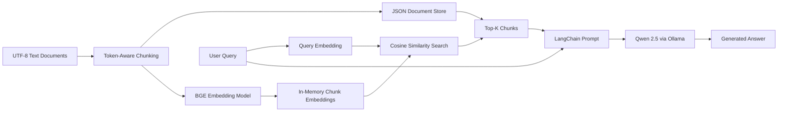

# Local Retrieval-Augmented Generation (RAG)

A lightweight, educational implementation of a Retrieval-Augmented Generation pipeline built with Python, Hugging Face Transformers, LangChain, and Ollama.

The application reads local text documents, splits them into overlapping chunks, generates semantic embeddings, retrieves the chunks most relevant to a query using cosine similarity, and asks a locally running Qwen 2.5 model to generate a context-aware answer.

## Architecture



## Features

- Reads multiple local text documents
- Token-aware document chunking
- Configurable chunk size
- Twenty-word overlap between consecutive chunks
- Semantic embeddings using `BAAI/bge-small-en-v1.5`
- Exhaustive cosine-similarity retrieval
- Configurable top-k retrieval
- Local answer generation using Qwen 2.5 and Ollama
- JSON-based document storage
- Source filenames and similarity scores in the console output
- No external vector database required

## How It Works

1. Files are loaded from the `documents` directory.
2. Each document is split into paragraphs and then into token-limited chunks.
3. Every document and chunk receives a UUID.
4. The chunks are written to `database/document_store.json`.
5. BGE generates an embedding for every chunk.
6. The query is embedded using the same model.
7. Cosine similarity is calculated between the query and every chunk.
8. The two highest-scoring chunks are retrieved.
9. Retrieved context and the query are passed to Qwen 2.5 through LangChain.
10. The query, retrieved sources, similarity scores, and generated answer are displayed in the terminal.

## Project Structure

```text
rag-implementation/
├── README.md
└── src/
    └── rag_implementation.py
```

The application expects the following directories to be created:

```text
rag-implementation/
├── database/
│   └── document_store.json     # Generated when the program runs
├── documents/
│   └── example.txt             # Your UTF-8 text documents
├── src/
│   └── rag_implementation.py
└── README.md
```

Document discovery is non-recursive. Files inside nested directories are not processed.

## Requirements

- Python 3.10 or newer recommended
- Ollama
- Enough memory to run the embedding model and Qwen 2.5
- Internet access during the initial model downloads

Python dependencies:

- `torch`
- `transformers`
- `numpy`
- `regex`
- `langchain-core`
- `langchain-ollama`

## Installation

### 1. Clone the repository

```bash
git clone git@github.com:praniil/rag-implementation.git
cd rag-implementation
```

### 2. Create a virtual environment

```bash
python3 -m venv .venv
source .venv/bin/activate
```

### 3. Install the dependencies

```bash
python -m pip install --upgrade pip
python -m pip install torch transformers numpy regex langchain-core langchain-ollama
```

### 4. Install and prepare Ollama

Install Ollama from [ollama.com](https://ollama.com/), then download Qwen 2.5:

```bash
ollama pull qwen2.5
```

Make sure the Ollama service is running:

```bash
ollama serve
```

If Ollama is already running as a desktop application or system service, this command is unnecessary.

### 5. Create the data directories

From the repository root:

```bash
mkdir -p documents database
```

Add one or more UTF-8 text files to `documents/`:

```text
documents/
├── election-results.txt
├── report.txt
└── notes.txt
```

## Usage

The current implementation uses paths relative to the `src` directory. Run it from there:

```bash
cd src
python rag_implementation.py
```

On its first run, Hugging Face downloads the `BAAI/bge-small-en-v1.5` tokenizer and model.

The application prints output similar to:

```text
════════════════════════════════════════════════════════════════════
                             RAG RESULT
════════════════════════════════════════════════════════════════════

User Query
────────────────────────────────────────────────────────────────────
  how many seats did rsp win?

Retrieved Context
────────────────────────────────────────────────────────────────────

[1] source: election-results | score: 0.8421
  Retrieved document text...

LLM Response
────────────────────────────────────────────────────────────────────
  Generated answer based on the retrieved context...
```

## Configuration

Configuration is currently defined directly inside `rag_implementation()`:

| Setting | Current value | Purpose |
|---|---:|---|
| Document directory | `../documents` | Location of source documents |
| Document store | `../database/document_store.json` | Generated chunk store |
| Embedding model | `BAAI/bge-small-en-v1.5` | Creates semantic embeddings |
| Chunk size | `200` tokens | Maximum approximate chunk length |
| Chunk overlap | `20` words | Context retained between chunks |
| Top results | `2` | Number of chunks retrieved |
| Ollama model | `qwen2.5:latest` | Generates the final answer |
| Query | `how many seats did rsp win?` | Question submitted to the pipeline |

To use a different question, update the `query` variable in `src/rag_implementation.py`:

```python
query = "What would you like to know?"
```

## Retrieval Approach

This project implements retrieval without a vector database.

Given a chunk embedding $c$ and query embedding $q$, cosine similarity is calculated as:

$$
\frac{c \cdot q}{\|c\|_2 \|q\|_2}
$$

All chunks are scored and sorted in descending order. The highest-scoring chunks are then mapped back to their original text through their document and chunk UUIDs.

## Document Store

The generated JSON store follows this general structure:

```json
{
  "document-uuid": {
    "chunk-uuid": {
      "text": "The chunk's text content.",
      "metadata": {
        "file_name": "source-file"
      }
    }
  }
}
```

The store is regenerated whenever the program runs. Chunk embeddings are held in memory and are not persisted.

## Current Scope and Limitations

This repository is a compact learning implementation rather than a production RAG service.

- The query and configuration are currently hardcoded.
- Only regular UTF-8 text files are supported.
- Document loading is not recursive.
- Embeddings are recomputed on every run.
- Retrieval performs a linear scan across every chunk.
- The JSON document store is overwritten on every run.
- Although two chunks are retrieved and displayed, the current prompt sends only the highest-ranked chunk to the LLM.
- There is no command-line interface, HTTP API, user interface, automated test suite, or dependency lock file.
- Very large document collections may require substantial memory and processing time.

For larger deployments, consider adding persistent embeddings, a vector database, batch processing, metadata filters, configurable prompts, reranking, and automated evaluation.

## Technology Stack

- [Python](https://www.python.org/)
- [PyTorch](https://pytorch.org/)
- [Hugging Face Transformers](https://huggingface.co/docs/transformers/)
- [BAAI BGE Small English v1.5](https://huggingface.co/BAAI/bge-small-en-v1.5)
- [LangChain](https://python.langchain.com/)
- [Ollama](https://ollama.com/)
- [Qwen 2.5](https://ollama.com/library/qwen2.5)

## License

No license has currently been added to this repository.
